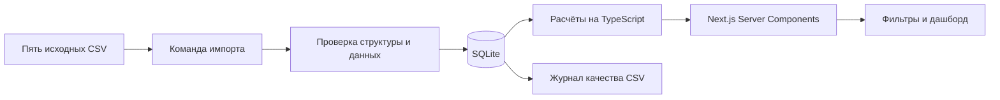
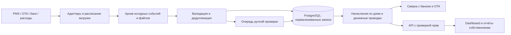

# Архитектура аналитики вилл

## Работающий прототип

### Хранение

- `batches`: неизменяемые снимки, SHA-256 полного набора и время создания.
- `files`: имя и хеш каждого файла в снимке.
- `raw_rows`: разобранные исходные строки с номером строки CSV, включая дубли и ошибки. Парсер убирает внешние пробелы; это не побайтовый архив CSV. Оригинальные файлы сохраняются в каталоге источников.
- `entities`: сущности со ссылкой на исходную строку, типом, бизнес-ID, объектом и решением об исключении. Поля сущностей сохранены в JSON; это осознанное упрощение прототипа.
- `issues`: замечания, решение и связанная запись для пересечений.
- `settings`: указатель на активный снимок.

Импорт не выполняется из веб-запросов. Сервер дашборда открывает базу только для чтения. Миграции и изменения выполняет локальная CLI-команда.

### Повторный импорт и изменения

Хеш полного набора строится из имён и хешей пяти файлов. Уже известный набор не создаёт новых строк: активируется существующий снимок. Изменённый набор сначала целиком проверяется, затем записывается одной SQLite-транзакцией. Ошибка формата CSV не меняет текущий снимок. Ошибочные бизнес-записи сохраняются с пометкой об исключении, чтобы импорт не скрывал проблему.

Полный снимок задаёт текущую картину: пропавшая из нового файла запись отсутствует в новом отчёте, но остаётся в старом снимке. Это не append-only поток платежей. Повторная загрузка старого набора явно возвращает старый снимок в активное состояние.

Версии бронирования внутри снимка сравниваются по `updated_at`. Противоречивые значения на одной дате не разрешаются порядком строк. Снимки можно сравнивать по типу и бизнес-ID через SQL; UI сравнения и журнал действий операторов не реализованы. Изменение правил расчёта требует миграции версии валидации или нового механизма перепроверки старых снимков: хеш сейчас учитывает только файлы.

## Будущая система

### Надёжность и аудит

- Идемпотентный ключ: источник + внешний ID + версия события. Для файлов дополнительно хеш файла и номер строки. Повтор доставки события не создаёт новую операцию.
- Хранить оригинальные файлы и события отдельно от обработанных записей; не перезаписывать историю. У каждой версии — источник, время получения, автор исправления, причина, значения до/после.
- Изменения проводить через проверяемые корректировки. Закрытый финансовый период не пересчитывать молча; политика корректировок согласуется с финансами.
- Разделять дату оказания услуги, дату операции, дату получения события и дату оплаты. Версионировать финансовые правила и курсы валют.
- Регулярно сверять начисления, выплаты OTA, удержанные комиссии, возвраты и банковские операции. Разницу не списывать автоматически.
- Резервные копии с проверкой восстановления, мониторинг неуспешных импортов и объёма исключённых сумм.

### Разграничение доступа

В прототипе авторизации нет; он слушает localhost и предназначен для синтетических данных. Не публиковать его как многопользовательский сервис без реализации прав.

| Роль                  | Доступ                                                           |
| --------------------- | ---------------------------------------------------------------- |
| Администратор         | Пользователи, роли и источники                                   |
| Финансовая команда    | Проверка ошибок, корректировки, закрытие периода и весь портфель |
| Операционный менеджер | Назначенные объекты; ограниченный набор данных                   |
| Собственник           | Только свои объекты и разрешённые отчёты                         |

Проверять права на сервере для каждой выборки и выгрузки. Переданный `property_id` не является разрешением на доступ. Для PostgreSQL использовать ограничения по организации и собственнику, при необходимости RLS. Учётные данные источников хранить в менеджере секретов; действия операторов записывать в аудит.

## Компромиссы

SQLite и синхронные расчёты подходят для этого набора и локальной демонстрации. Обработка пересечений сейчас квадратичная; при росте объёма нужны алгоритм по отсортированным интервалам, индексы и фоновые расчёты. Для нескольких серверов и конкурентных импортов перейти на PostgreSQL и очередь задач. Развёртывание с SQLite требует постоянного диска; эфемерная serverless-файловая система не подходит.
